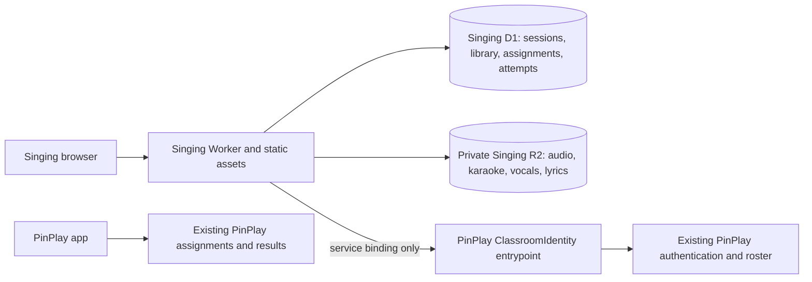

# Singing classroom audit and implementation

## Repository audit

Audited Singing `9b64227d6d563091f3832ac812c21c7117137de0` and PinPlay
`041ab6e5af65b1b27c7763e5e3a18653bef2d8ed` before implementation.

| Area | Existing implementation | Reuse / change |
| --- | --- | --- |
| Singing music and activities | Static browser app, native music players and lyric games | Preserve the players and activities; add private media URLs and assignment context. |
| Singing persistence | Local song metadata, IndexedDB media, local classroom scores | Add private R2 song bundles and Singing D1 records; retain old originals during migration. |
| PinPlay teacher authentication | Owner password verification and signed guest workspace invitations | Reuse verification inside PinPlay through a named service entrypoint. |
| PinPlay students and classes | Google verification, signed student sessions and roster in the assignments Durable Object | Reuse identities, enrollment policy and current class labels; fail closed on roster errors. |
| PinPlay data | SQLite-backed `QuizRoom` Durable Object and R2 `pinplay-quiz-media` | Preserve existing bindings, public routes, assignments and quiz results. PinPlay currently does **not** use D1. |
| PinPlay media access | Public media route for existing quiz assets | Keep Singing music in a separate private bucket behind authorization. |
| Shared teacher permissions | Owner/workspace roles; no existing Google teacher-to-class grants | Add an owner-managed teacher directory alongside the roster, with class grants. |

## Architecture

The browser uses an HttpOnly, Secure, same-origin session cookie. Singing stores
only its hash and calls PinPlay to verify current access. PinPlay signs credentials
with an application-specific derived key; no signing or Cloudflare secrets are
copied to Singing. Students use the same Google accounts; this is shared identity
with separate application sessions, rather than a cross-domain browser cookie.

R2 objects have opaque keys. Teacher-owned immutable manifests reference verified
audio assets. Saving creates a revision; assignment publication pins that revision.
Playback URLs last ten minutes, are bound to a session, and recheck authorization
on every request. Source files, folder metadata and teacher notes are withheld from
student responses. No bucket listing or public media endpoint exists.

Singing D1 owns all Singing assignment and result records. Each assigned activity
has its own attempt allowance. Word activities are graded from stored answers;
other game measurements are labeled browser-reported or completion-only. Existing
PinPlay export remains optional and separate from this assignment flow.

## Phases implemented

1. **Private library:** original/karaoke/vocals uploads, MP3 conversion with source
   retention, synchronized lyrics/metadata, revision checks, folder import/watch,
   cross-device reads and repeatable legacy migration. A portable audio-inclusive
   backup transfers old data when the cloud app uses a different hosting origin.
2. **Shared identity:** existing owner/workspace verification, Google students,
   current rosters, scoped Google teachers, revocation and separate sessions.
   Guest workspace invitations can manage their own songs; class assignment
   access requires an explicit named teacher grant or the owner account.
3. **Native assignments:** classes, activities, deadlines, attempt limits,
   resumable word answers, results, not-started/completion summaries and CSV export.
4. **Validation and rollout preparation:** isolated Worker/D1/R2 tests, native
   browser checks, existing Singing and PinPlay regressions, both Worker bundles,
   deployable migrations and a portable companion patch.

Production deployment has not been performed. See [deployment and recovery](CLOUD_DEPLOYMENT.md)
for provisioning, Google origin configuration, quota limits and release steps.

## Cost and operational boundaries

Reuse the existing Cloudflare account and PinPlay Worker/Durable Object. Add one
Singing Worker, one dedicated D1 database and one private R2 bucket; no extra
identity provider, media signing service or credential store is needed. Defaults
limit files to 64 MB and each teacher library to 1 GB, including retained versions
and pending reservations. No microphone recordings are uploaded.

Song deletion revokes access immediately but retains stored objects and historical
versions. There is intentionally no automatic object cleanup. Storage retention
and larger quotas require a deliberate administrator policy. Folder scanning runs
while the app is open; it does not install a background operating-system service.

PinPlay classes currently have labels rather than durable class IDs. Renaming a
class changes the derived ID and requires reviewing assignment targets and teacher
grants. Roster editing remains in PinPlay.
